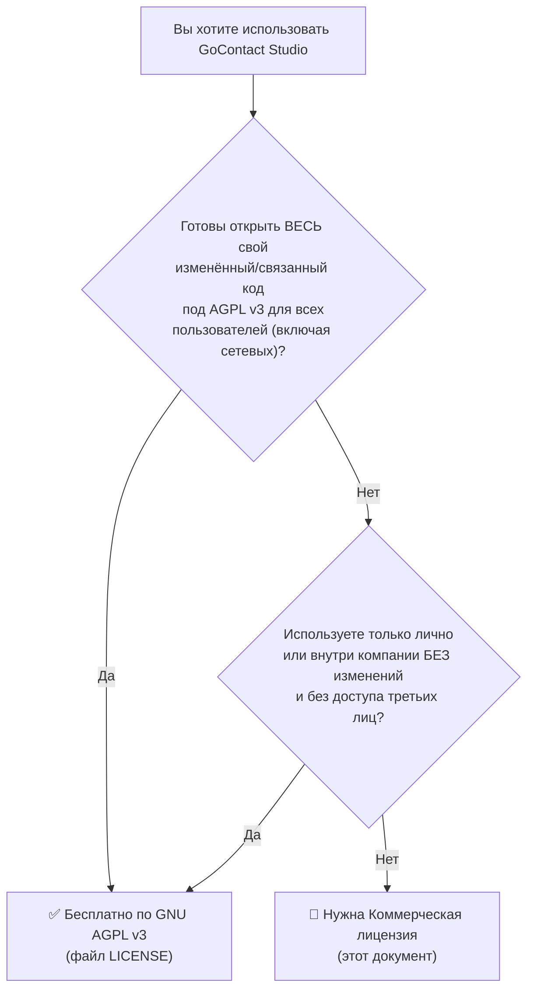

# 💼 Коммерческая лицензия GoContact Studio (Commercial License)

> [!IMPORTANT]
> Этот документ — **публичное описание условий** коммерческой лицензии. Сам договор заключается **отдельно, в письменной форме** с Правообладателем. Без подписанного договора единственная лицензия, по которой вы можете использовать код, — **GNU AGPL v3** (файл [LICENSE](./LICENSE)).

* **Правообладатель (Licensor):** Толеген Манасов (Tolegen Manassov), GitHub: `trollyHUB`
* **Контакт:** `tolegen.manasov05@gmail.com` (тема письма: `GoContact Commercial License`)
* **SPDX выражение проекта:** `AGPL-3.0-only OR LicenseRef-GoContact-Commercial`

---

## 1. Как работает двойное лицензирование

Правообладатель — единственный владелец авторских прав на весь код после смены лицензии (а вклады сторонних авторов принимаются только по [CLA.md](./CLA.md)). Поэтому условия AGPL обязывают **всех остальных**, а Правообладатель вправе **дополнительно** выдавать код на иных условиях.

## 2. Когда коммерческая лицензия ОБЯЗАТЕЛЬНА

Вам нужна коммерческая лицензия, если вы хотите сделать хотя бы одно из перечисленного **и не хотите выполнять условия AGPL v3**:

| № | Сценарий | Почему AGPL этого не позволяет без раскрытия кода |
| :---: | :--- | :--- |
| 1 | Встроить GoContact Studio (или его часть, модуль, алгоритм, UI) в **закрытый проприетарный продукт** | Производное произведение должно распространяться под AGPL v3 (ст. 5) |
| 2 | Запустить изменённую версию как **SaaS / облачный сервис / хостинг** для клиентов | Ст. 13 обязывает предложить всем сетевым пользователям исходный код изменённой версии |
| 3 | Продавать **white-label** версию под своим брендом без публикации исходников | Ст. 5, 6 + запрет на бренд в [TRADEMARK.md](./TRADEMARK.md) |
| 4 | Поставлять программу в **устройствах/ПО заказчику** с запретом на модификацию (Tivoization, DRM) | Ст. 6 «Installation Information», ст. 3 (анти-DRM) |
| 5 | Распространять без передачи покупателю прав по AGPL (закрытая EULA) | Ст. 10, 12: нельзя накладывать дополнительные ограничения |
| 6 | Использовать в продукте, где юридический отдел **запрещает copyleft-лицензии** | Политика компании, а не AGPL — но решается только коммерческой лицензией |

## 3. Когда коммерческая лицензия НЕ нужна

* Личное использование, в том числе в работе (адресная книга, CRM для себя).
* Использование **без изменений** внутри компании, когда доступ имеют только её сотрудники.
* Self-hosted развёртывание (Docker) **без изменений** кода — даже с внешними пользователями (вы просто указываете ссылку на официальный репозиторий как источник).
* Изменения кода с **полным открытием** изменений под AGPL v3.
* Учебные, исследовательские, некоммерческие проекты, соблюдающие AGPL.
* Написание плагинов, которые общаются с GoContact Studio **только** через публичные стабильные интерфейсы (REST API, MCP, Wasm ABI) и не включают код проекта — см. §6.

## 4. Уровни коммерческой лицензии (ориентир)

| Уровень | Для кого | Что даёт |
| :--- | :--- | :--- |
| **Startup** | Компании с выручкой < \$1 млн/год | Закрытые модификации, внутреннее распространение, до 50 пользователей |
| **Business** | Средний бизнес | Закрытый SaaS/хостинг, white-label без бренда GoContact, приоритетная поддержка |
| **Enterprise / OEM** | Корпорации, интеграторы, производители ПО | Встраивание в собственные продукты, перераспределение, SLA, юридические гарантии (indemnification) |

Типовой договор коммерческой лицензии доступен для ознакомления в [docs/legal/COMMERCIAL_LICENSE_TEMPLATE.md](./docs/legal/COMMERCIAL_LICENSE_TEMPLATE.md). Цены и точный объём прав определяются в индивидуальном договоре. Все коммерческие лицензии:
* **не передают** авторские права и права на товарный знак;
* **не являются** исключительными (Правообладатель продолжает выпускать код под AGPL v3);
* действуют на **конкретные версии** и срок, указанные в договоре;
* **не распространяются** на сторонние компоненты (см. [THIRD_PARTY_NOTICES.md](./THIRD_PARTY_NOTICES.md)) — их лицензии соблюдаются отдельно.

## 5. Последствия нарушения

Использование кода в сценариях из §2 **без** коммерческой лицензии и **без** соблюдения AGPL v3 является нарушением авторских прав. Согласно ст. 8 AGPL v3, права по лицензии **автоматически прекращаются**. Правообладатель вправе:
1. направить уведомление о нарушении (срок устранения — 30 дней, ст. 8 AGPL v3);
2. подать DMCA Takedown на GitHub / хостинг-провайдеру;
3. требовать компенсации в судебном порядке по законодательству об авторском праве (в т.ч. РК — Закон «Об авторском праве и смежных правах», Бернская конвенция).

## 6. Граница «производного произведения» и исключение для плагинов

Для прозрачности Правообладатель публично заявляет, как он толкует границу AGPL:

| Ситуация | Позиция |
| :--- | :--- |
| Вызов REST API / MCP / CardDAV из отдельной программы по сети | **Не производное** — AGPL не распространяется на вашу программу |
| Wasm-плагин, использующий только опубликованный Plugin ABI и не содержащий кода проекта | **Не производное** — действует официальное исключение [PLUGIN_EXCEPTION.md](./PLUGIN_EXCEPTION.md) |
| Импорт Go-пакетов `internal/...` или копирование файлов/алгоритмов | **Производное** — AGPL или коммерческая лицензия |
| Форк с изменениями, запущенный как сервис | **Производное + ст. 13** |
| Перенос кода на другой язык (Rust, Python, TS) с сохранением структуры | **Производное** (перевод — это переработка произведения) |
