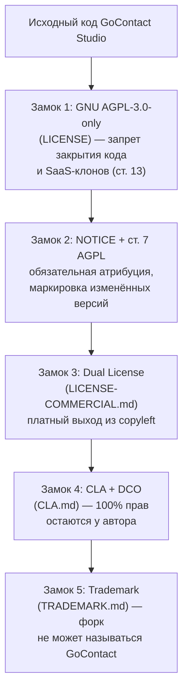
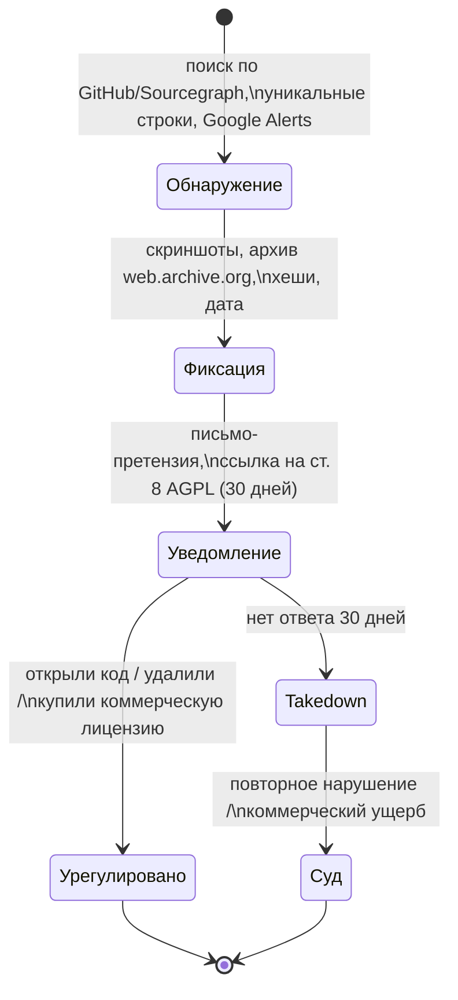

# ⚖️ Полное руководство по лицензированию и защите GoContact Studio (Licensing & IP Protection Guide)

* **Документ:** `docs/legal/LICENSING_GUIDE.md`
* **Редакция:** 1.0 от 2026-10-25
* **Связанные файлы:** [LICENSE](../../LICENSE) · [NOTICE](../../NOTICE) · [LICENSE-COMMERCIAL.md](../../LICENSE-COMMERCIAL.md) · [TRADEMARK.md](../../TRADEMARK.md) · [PLUGIN_EXCEPTION.md](../../PLUGIN_EXCEPTION.md) · [CLA.md](../../CLA.md) · [THIRD_PARTY_NOTICES.md](../../THIRD_PARTY_NOTICES.md) · [licenses/](../../licenses/) · [COMMERCIAL_LICENSE_TEMPLATE.md](./COMMERCIAL_LICENSE_TEMPLATE.md)

> [!CAUTION]
> Этот документ составлен как инженерно-правовая схема на основе официальных текстов GNU AGPL v3 и практики проектов Grafana, Twenty, Nextcloud, MongoDB, Sentry. Он **не является юридической консультацией**. Перед заключением первого коммерческого договора и регистрацией товарного знака рекомендуется проверка юристом по ИС (в РК — патентный поверенный).

---

## 1. Архитектура защиты: «Пять замков»



| Замок | Что защищает | Файл |
| :---: | :--- | :--- |
| 1 | Код не может быть закрыт ни при распространении, ни при работе по сети | `LICENSE` |
| 2 | Ваше имя нельзя удалить; изменённые версии обязаны помечаться | `NOTICE`, SPDX-заголовки |
| 3 | Компании, не желающие открывать код, обязаны платить | `LICENSE-COMMERCIAL.md` |
| 4 | Чужие PR не размывают права, двойная лицензия остаётся возможной | `CLA.md`, `.github/workflows/cla.yml` |
| 5 | Имя и логотип принадлежат только вам | `TRADEMARK.md` |

---

## 2. Почему именно `AGPL-3.0-only`, а не `-or-later`

* `AGPL-3.0-or-later` позволил бы любому применить **будущую** версию AGPL, которую пишет FSF, а не вы. Условия могут измениться.
* `AGPL-3.0-only` фиксирует текст навсегда. Решение о переходе на новую версию остаётся за Правообладателем (что возможно благодаря CLA).
* SPDX-выражение проекта: `AGPL-3.0-only OR LicenseRef-GoContact-Commercial`.

## 3. Сравнение всех рассмотренных лицензий

| Лицензия | OSI | Закрытие кода | SaaS-клон | Прямой запрет коммерции | Доверие сообщества | Итог |
| :--- | :---: | :---: | :---: | :---: | :---: | :---: |
| MIT / Apache-2.0 | ✅ | разрешено | разрешено | нет | максимальное | ❌ нет защиты |
| GPL-3.0 | ✅ | запрещено | **разрешено** (SaaS loophole) | нет | высокое | ⚠️ дыра |
| **AGPL-3.0-only** | ✅ | запрещено | запрещено без открытия кода | нет (платный выход через dual) | высокое | 🏆 **выбрано** |
| FSL-1.1 / BSL-1.1 | ❌ | запрещено | запрещено | да (2–4 года) | среднее, «не open source» | резерв |
| SSPL | ❌ | запрещено | запрещено | фактически да | низкое, отклонена OSI | ❌ |
| Commons Clause | ❌ | — | — | да | низкое | ❌ |

**Почему не FSL/BSL сейчас:** проект только набирает сообщество; статус «настоящего open source» (OSI) важен для звёзд, контрибьюторов, включения в дистрибутивы Linux и каталоги. FSL оставлен как запасной вариант (см. §9).

---

## 4. Матрица угроз: каждая «дыра» и как она закрыта

| № | Угроза / лазейка | Чем закрыта | Остаточный риск |
| :---: | :--- | :--- | :--- |
| 1 | Компания берёт код и встраивает в закрытый продукт | AGPL ст. 5(c): всё производное — под AGPL | Нарушение нужно обнаружить → §7 мониторинг |
| 2 | Конкурент запускает изменённую копию как платный SaaS, не раздавая бинарники | **AGPL ст. 13**: обязан предложить исходник всем сетевым пользователям | Неизменённая копия как SaaS разрешена (но без бренда, замок 5) |
| 3 | SaaS-клон без изменений под вашим брендом | `TRADEMARK.md` + AGPL ст. 7(e) | Нужна регистрация знака для сильной защиты в суде |
| 4 | Удаление вашего имени из кода/интерфейса | `NOTICE` + AGPL ст. 7(b) + SPDX-заголовки во всех `.go` | — |
| 5 | Форк выдаётся за оригинал | AGPL ст. 7(c) + TRADEMARK §4 | — |
| 6 | Контрибьютор позже требует удалить свой код / запрещает коммерческую лицензию | `CLA.md` §2: безотзывная лицензия с правом сублицензирования | Нужно реально собирать подписи (Action) |
| 7 | Контрибьютор вносит чужой GPL/проприетарный код | CLA §5 гарантии + DCO `Signed-off-by` + ревью | Проверка `go-licenses` в CI |
| 8 | Патентный «тролль» среди контрибьюторов | AGPL ст. 11 + CLA §3 патентная лицензия с прекращением при иске | — |
| 9 | Зависимость под GPL/SSPL ломает коммерческую лицензию | `THIRD_PARTY_NOTICES.md` §2 + `go-licenses check` | — |
| 10 | Добавление «доп. ограничений» в форке (закрытая EULA) | AGPL ст. 7 (последний абзац) и ст. 10: такие ограничения можно удалить | — |
| 11 | Tivoization: поставка на устройствах с блокировкой модификации | AGPL ст. 6 «Installation Information» | — |
| 12 | Обход через DRM / анти-обходные законы | AGPL ст. 3 | — |
| 13 | Переписывание кода на другом языке (Rust/TS) «своими словами» | Перевод = переработка произведения (Бернская конвенция ст. 8, 12); LICENSE-COMMERCIAL §6 | Чистая переработка идей (clean-room) законна: идеи и алгоритмы не охраняются авторским правом |
| 14 | Несанкционированное копирование технической документации | Документация — объект авторского права, лицензирована вместе с репозиторием под AGPL; 7(b) атрибуция | — |
| 15 | Использование старой версии v0.1.0 под MIT | **Не закрывается**: MIT-релиз безотзывен | Ограничен: v0.1.0 — только базовая адресная книга; всё новое — под AGPL |
| 16 | Обучение ИИ-моделей на коде | Не регулируется AGPL однозначно; можно добавить `ai.txt`/`robots` сигналы | Правовая неопределённость в мире |
| 17 | Нарушитель в юрисдикции, не признающей решения | Бернская конвенция (181 страна, включая РК) | Стоимость трансграничных исков |
| 18 | Собственное нарушение ст. 13 при запуске серверного режима | Обязательная ссылка «Source code» в веб-UI и эндпоинт `GET /api/v1/source` (план v0.2.0) | Внедрить до релиза веб-режима |

---

## 5. Обязанности самого проекта (чтобы лицензия была чистой)

1. **SPDX-заголовок в каждом исходном файле** (`.go`, `.ts`, `.tsx`, `.ps1`):
   ```go
   // SPDX-License-Identifier: AGPL-3.0-only OR LicenseRef-GoContact-Commercial
   // Copyright (C) 2026 Tolegen Manassov (trollyHUB). See NOTICE.
   ```
2. **Атрибуция в UI:** окно «О программе» и вывод `--version` содержат строку из NOTICE §2.
3. **Соответствие ст. 13** для серверного/браузерного режима: ссылка «Исходный код (AGPL v3)» в подвале веб-интерфейса + `GET /api/v1/source` возвращает URL репозитория и commit hash сборки.
4. **Бинарные релизы** содержат `LICENSE`, `NOTICE`, `THIRD_PARTY_NOTICES.md` и папку `licenses/`.
5. **Docker-образ** содержит метки OCI:
   ```dockerfile
   LABEL org.opencontainers.image.licenses="AGPL-3.0-only OR LicenseRef-GoContact-Commercial"
   LABEL org.opencontainers.image.source="https://github.com/trollyHUB/gocontact-studio"
   ```
6. **CI-проверки:** наличие SPDX-заголовков, `go-licenses check`, подпись CLA на каждом PR.

---

## 6. Исключение для плагинов (Plugin Exception — позиция Правообладателя)

Чтобы экосистема Wasm-плагинов (`v0.9.0`) могла развиваться, Правообладатель заявляет: плагины, которые
* взаимодействуют с GoContact Studio **только** через опубликованный Plugin ABI, REST API, MCP или CardDAV, и
* **не содержат** кода, скопированного из репозитория,

не считаются производными произведениями, и их авторы вправе выбирать для них **любую** лицензию, включая проприетарную. Это заявление является официальным дополнительным разрешением (AGPL ст. 7, «additional permissions») и зафиксировано в отдельном файле [`PLUGIN_EXCEPTION.md`](../../PLUGIN_EXCEPTION.md).

---

## 7. Процедура при обнаружении нарушения



* AGPL ст. 8: при первом нарушении права **восстанавливаются**, если нарушитель устранил нарушение в течение 30 дней после уведомления.
* Для ускорения обнаружения рекомендуется встроить «водяные знаки» — уникальные строковые константы и комментарии, по которым легко найти копию кода поиском.

---

## 8. Регистрация и юридическое усиление (план действий автора)

| Шаг | Действие | Срок | Зачем |
| :---: | :--- | :--- | :--- |
| 1 | Смена лицензии на AGPL-3.0-only в репозитории (этот коммит) | ✅ сейчас | Основа защиты |
| 2 | Включить CLA Assistant (`.github/workflows/cla.yml`) и защиту ветки `main` | сейчас | Замок 4 |
| 3 | Депонирование кода (свидетельство на программу для ЭВМ) в **НИИС РК / Kazpatent** | 1–2 мес. | Доказательство авторства и даты |
| 4 | Регистрация словесного знака «GoContact Studio» в НИИС РК (классы МКТУ 9 и 42) | 6–12 мес. | Знак ® и сильная защита бренда |
| 5 | Международная регистрация через Мадридскую систему WIPO | после шага 4 | Защита бренда за рубежом |
| 6 | Шаблон коммерческого договора, проверенный юристом | до первой продажи | Замок 3 |
| 7 | Регистрация доменов `gocontact.studio`, `gocontactstudio.com` и имён в Docker Hub / npm | сейчас | Предотвращение киберсквоттинга |

---

## 9. Стратегические сценарии на будущее

| Сценарий | Действие |
| :--- | :--- |
| Крупный облачный провайдер всё же продаёт неизменённую копию как сервис | Переход новых версий на `FSL-1.1-ALv2` (возможно только благодаря CLA) |
| Проект становится фондом/сообществом | Передача знака в фонд, сохранение AGPL |
| Нужен максимальный рост распространения SDK | SDK/клиентские библиотеки (`pkg/sdk`) выпускаются под `Apache-2.0`, ядро — под AGPL |

---

## 10. FAQ

**Можно ли мне (автору) продавать программу, если она под AGPL?** Да. Как правообладатель вы не связаны собственной лицензией.

**Обязан ли обычный пользователь что-то открывать?** Нет. Обязанности возникают только при распространении или предоставлении **изменённой** версии по сети.

**Компания поставила GoContact Studio в Docker для сотрудников без изменений — нарушение?** Нет.

**Можно ли запретить коммерческое использование вообще в AGPL?** Нет — это противоречит определению open source и такое ограничение может быть удалено получателем (ст. 7, 10). Защита от коммерции работает через copyleft + коммерческую лицензию + бренд.

**Что со старым релизом v0.1.0 под MIT?** Он навсегда остаётся под MIT. Но в нём нет ни графа, ни CRM, ни чатов, ни синхронизации — вся ценность будущих версий создаётся уже под AGPL.
